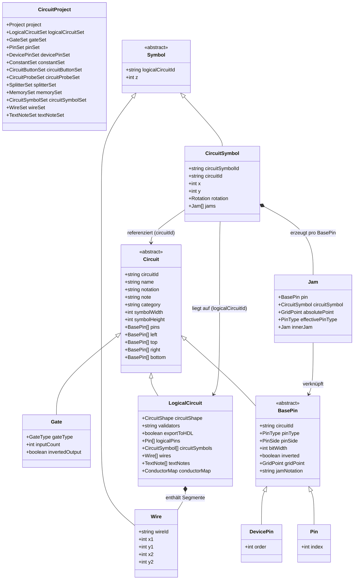

# Datenmodell & Simulations-Architektur (Referenz-Spezifikation)

[← Zurück zur Übersicht](intro.md) • [📋 Zum Scrum-Board](scrum-board.md)

Dieses Dokument spezifiziert das zentrale Datenmodell für **Logic Circuit Web** auf Basis des C#-Originalprojekts von Eugene Lepekhin (`reference/LogicCircuit`). Es dient als verbindliche architektonische Grundlage für das Typsystem (`src/types/`), die Modell- und Zustandsverwaltung (`CircuitContext`) sowie die anschließende 1:1-Portierung der Simulations-Engine (`Runner` und `Function`).

---

## Architekturprinzip: Definition vs. Platzierung

Das C#-Original trennt strikt zwischen **logischer Bauteil-Definition (`Circuit`)**, **konkreter Platzierung auf einem Schaltplan (`CircuitSymbol`)**, **abstrakter Pin-Beschreibung (`BasePin`)** und **konkretem Raster-Anschlusspunkt (`Jam`)**.



### Warum diese Trennung für Editor und Simulation essenziell ist
- **Wiederverwendbarkeit von Gattern (`Gate`):** Alle platzierten Gatter gleichen Typs (z. B. jedes `AND`-Gatter mit 2 Eingängen) teilen sich dieselbe `Gate`-Definition. Jede Platzierung auf dem Canvas erzeugt lediglich ein leichtgewichtiges `CircuitSymbol` mit `(x, y, rotation)`.
- **Nahtlose Hierarchie (`LogicalCircuit` ist ein `Circuit`):** Da eine Schaltung (`LogicalCircuit`) selbst von `Circuit` erbt und ihre Ein-/Ausgänge über `Pin`-Bausteine definiert, kann jedes `LogicalCircuit` ohne Sonderbehandlung als `CircuitSymbol` (Sub-Circuit) in eine übergeordnete Schaltung eingefügt werden.
- **Rotation und Pin-Geometrie (`BasePin` vs. `Jam`):** Ein `BasePin` kennt nur seine relative Position (`gridPoint`) auf dem unrotierten Bauteil. Erst das `Jam` verbindet `BasePin` + `CircuitSymbol` und berechnet daraus den tatsächlichen `absolutePoint` auf dem Canvas-Raster inklusive Rotation.
- **Topologische Leitungsnetze (`Wire` vs. `Conductor`):** Ein `Wire` speichert keine Quell- oder Ziel-Pin-IDs, sondern ist ein reines Liniensegment `(x1, y1) -> (x2, y2)` auf dem Raster. Erst die `ConductorMap` verschmilzt berührende `Wire`-Segmente zu elektrischen Netzen (`Conductor`). Die Simulation prüft anschließend, welche `Jam.absolutePoint`-Koordinaten auf demselben `Conductor` liegen.

---

## Dateistruktur für Typdefinitionen (`src/types/`)

Gemäß den [Coding Rules](coding-rules.md) gilt für alle TypeScript-Typen in `src/types/` die Regel **„Ein Typ pro Datei mit Default-Export"** sowie `"type over interface"`. Logisch zusammengehörige Typen werden in thematischen Unterverzeichnissen gruppiert:

```text
src/types/
├── canvas/                       # Viewport-, Kamera- und Auswahl-Typen
│   ├── canvasPoint.ts
│   ├── cursorCoordinates.ts
│   ├── gridPoint.ts
│   ├── selectionBox.ts
│   └── viewportTransform.ts
├── circuit/                      # Kern-Datenmodell analog zu CircuitProject
│   ├── basePin.ts
│   ├── circuit.ts
│   ├── circuitButton.ts
│   ├── circuitProbe.ts
│   ├── circuitProject.ts
│   ├── circuitShape.ts
│   ├── circuitSymbol.ts
│   ├── collapsedCategory.ts
│   ├── conductor.ts
│   ├── conductorMap.ts
│   ├── constant.ts
│   ├── devicePin.ts
│   ├── gate.ts
│   ├── gateType.ts
│   ├── graphicsArray.ts
│   ├── jam.ts
│   ├── ledMatrix.ts
│   ├── ledMatrixCellShape.ts
│   ├── ledMatrixType.ts
│   ├── logicalCircuit.ts
│   ├── memory.ts
│   ├── memoryOnStart.ts
│   ├── pin.ts
│   ├── pinSide.ts
│   ├── pinType.ts
│   ├── project.ts
│   ├── rotation.ts
│   ├── sensor.ts
│   ├── sensorType.ts
│   ├── sound.ts
│   ├── splitter.ts
│   ├── textNote.ts
│   └── wire.ts
└── simulation/                   # Laufzeit- und Compiler-Typen analog zu Runner/Function
    ├── circuitFunction.ts
    ├── circuitMap.ts
    ├── circuitState.ts
    ├── connection.ts
    ├── connectionSet.ts
    ├── signalState.ts
    └── symbolMap.ts
```

*(Hinweis: Der obige Baum zeigt die C#-Kernmodelle; weiterführende Web-Feature-Typen liegen thematisch geordnet in den Geschwisterverzeichnissen `collab/`, `find/`, `hdl/`, `history/`, `mcp/`, `settings/` und `storage/` sowie `synthesizer.ts` unter `circuit/`.)*

Jede Datei exportiert genau ihren Typ als Default-Export:

```ts
import GridPoint from "../canvas/gridPoint";
import PinSide from "./pinSide";
import PinType from "./pinType";

type BasePin = {
  pinId: string;
  circuitId: string;
  bitWidth: number;
  pinType: PinType;
  pinSide: PinSide;
  inverted: boolean;
  name: string;
  note: string;
  jamNotation: string;
  gridPoint: GridPoint;
};

export default BasePin;
```

---

## Referenz-Mapping: C#-Vorlage zu TypeScript

Die folgenden Abschnitte beschreiben alle Entitäten des C#-Originals aus [`CircuitProject.xml`](../reference/LogicCircuit/Sources/LogicCircuit/Schema/CircuitProject.xml) und deren exakte Semantik.

### Grundlegende Enumerationen und Wertetypen

| Typ in TS (`src/types/circuit/`) | C#-Referenz | Werte & Bedeutung |
| :--- | :--- | :--- |
| `GateType` (`gateType.ts`) | [`GateType.cs`](../reference/LogicCircuit/Sources/LogicCircuit/CircuitProject/GateType.cs) | `"nop"` \| `"clock"` \| `"not"` \| `"or"` \| `"and"` \| `"xor"` \| `"led"` \| `"triState1"` \| `"triState2"` *(Hinweis: `Odd`, `Even`, `Probe` sind im Original als veraltet markiert; `NAND`, `NOR`, `XNOR` sind `and`/`or`/`xor` mit `invertedOutput = true`)* |
| `PinType` (`pinType.ts`) | [`PinType.cs`](../reference/LogicCircuit/Sources/LogicCircuit/CircuitProject/PinType.cs) | `"none"` \| `"input"` \| `"output"` (`"none"` wird bei `Splitter`-Pins und dem internen `DevicePin` eines `Pin`-Bausteins verwendet) |
| `PinSide` (`pinSide.ts`) | [`PinSide.cs`](../reference/LogicCircuit/Sources/LogicCircuit/CircuitProject/PinSide.cs) | `"left"` \| `"top"` \| `"right"` \| `"bottom"` |
| `Rotation` (`rotation.ts`) | [`Rotation.cs`](../reference/LogicCircuit/Sources/LogicCircuit/CircuitProject/Rotation.cs) | `"up"` (0°) \| `"right"` (90°) \| `"down"` (180°) \| `"left"` (-90°) |
| `CircuitShape` (`circuitShape.ts`) | [`CircuitShape.cs`](../reference/LogicCircuit/Sources/LogicCircuit/CircuitShape.cs) | `"rectangular"` \| `"display"` \| `"mux"` \| `"demux"` \| `"alu"` \| `"flipFlop"` (Darstellungsform eines `LogicalCircuit`) |
| `MemoryOnStart` (`memoryOnStart.ts`) | [`MemoryOnStart.cs`](../reference/LogicCircuit/Sources/LogicCircuit/CircuitProject/MemoryOnStart.cs) | `"random"` \| `"zeros"` \| `"ones"` \| `"data"` (Startzustand von RAM/GraphicsArray) |
| `SensorType` (`sensorType.ts`) | [`SensorType.cs`](../reference/LogicCircuit/Sources/LogicCircuit/CircuitProject/SensorType.cs) | `"random"` \| `"manual"` \| `"series"` \| `"loop"` \| `"ascii"` \| `"keyCode"` \| `"sequence"` \| `"clock"` |
| `LedMatrixType` (`ledMatrixType.ts`) | [`LedMatrixType.cs`](../reference/LogicCircuit/Sources/LogicCircuit/CircuitProject/LedMatrixType.cs) | `"individual"` \| `"selector"` |
| `LedMatrixCellShape` (`ledMatrixCellShape.ts`) | [`LedMatrixCellShape.cs`](../reference/LogicCircuit/Sources/LogicCircuit/CircuitProject/LedMatrixCellShape.cs) | `"round"` \| `"rect"` |
| `SignalState` (`signalState.ts`) | [`State.cs`](../reference/LogicCircuit/Sources/LogicCircuit/Function/State.cs) | `"off"` (`State.Off` / Tri-State `z`, numerisch `0`) \| `"on0"` (`State.On0` / Low `0`, numerisch `1`) \| `"on1"` (`State.On1` / High `1`, numerisch `2`) |
| `GridPoint` (`gridPoint.ts`) | [`GridPoint.cs`](../reference/LogicCircuit/Sources/LogicCircuit/GridPoint.cs) | `{ x: number; y: number }` in ganzzahligen Rastereinheiten (`GridSize = 18px`, `PinRadius = 3px` gemäß [`Symbol.cs`](../reference/LogicCircuit/Sources/LogicCircuit/CircuitProject/Symbol.cs#L10-L11)) |

---

### Projekt-Container: `CircuitProject` & `Project`

**C#-Referenz:** [`CircuitProject.xml`](../reference/LogicCircuit/Sources/LogicCircuit/Schema/CircuitProject.xml#L32-L70), [`CircuitProject.cs`](../reference/LogicCircuit/Sources/LogicCircuit/CircuitProject/CircuitProject.cs), [`Project.cs`](../reference/LogicCircuit/Sources/LogicCircuit/CircuitProject/Project.cs), [`CollapsedCategory.cs`](../reference/LogicCircuit/Sources/LogicCircuit/CircuitProject/CollapsedCategory.cs)

- **`Project`:**
  - `projectId`: Eindeutige Projekt-ID (UUID/GUID).
  - `name`: Projektname (Standard: `"Circuit Project"`).
  - `note`: Projektbeschreibung.
  - `zoom`: Aktueller Zoomfaktor (`0.1` bis `3.0`, Standard `1.0`).
  - `frequency`: Ziel-Taktfrequenz in Hz (`1` bis `50`, Standard `10`).
  - `isMaximumSpeed`: Ob die Simulation ohne Taktbremse mit maximaler Geschwindigkeit läuft (`boolean`, Standard `false`).
  - `logicalCircuitId`: Referenz auf das aktuell im Editor geöffnete `LogicalCircuit`.
  - `startupCircuitId`: Optionale Referenz auf das beim Projektstart bzw. Simulationsstart anzuzeigende `LogicalCircuit`.
  - `categoryTextNoteCollapsed`, `categoryInputOutputCollapsed`, `categoryPrimitivesCollapsed`: Einklappzustand der Standard-Palettenkategorien.
- **`CollapsedCategory`:**
  - Speichert die Namen eingeklappter benutzerdefinierter Sub-Circuit-Kategorien.
- **`CircuitProject`:**
  - Wurzel-Container, der das `Project`-Objekt sowie alle Entitäts-Sammlungen (`logicalCircuits`, `gates`, `pins`, `devicePins`, `constants`, `circuitButtons`, `circuitProbes`, `splitters`, `memories`, `ledMatrices`, `sensors`, `sounds`, `graphicsArrays`, `circuitSymbols`, `wires`, `textNotes`) verwaltet.
  - Stellt referentielle Integrität sicher (vgl. [`CircuitProject.ValidateCircuitProject()`](../reference/LogicCircuit/Sources/LogicCircuit/CircuitProject/CircuitProject.cs#L279-L334)):
    - Jedes individuelle Bauteil (`CircuitProbe`, `CircuitButton`, `Constant`, `Pin`, `Splitter`, `Memory`, `LedMatrix`, `Sensor`, `Sound`, `GraphicsArray`) besitzt **genau ein** zugehöriges `CircuitSymbol` (`circuitSymbolSet.selectByCircuit(circuit).length === 1`).
    - Ein `DevicePin` besitzt **niemals** ein eigenes `CircuitSymbol`.
    - `Gate` und `LogicalCircuit` können **beliebig viele** (0..n) `CircuitSymbol`-Instanzen besitzen.
    - Kein `Wire` darf identische Endpunkte haben (`point1 !== point2`).

---

### Bauteil-Hierarchie: `Circuit` und seine Subklassen

#### Abstrakte Basis `Circuit`
**C#-Referenz:** [`Circuit.cs`](../reference/LogicCircuit/Sources/LogicCircuit/CircuitProject/Circuit.cs)

Jedes platzierbare Objekt ist ein `Circuit` mit einer eindeutigen `circuitId`.
- **Gemeinsame Eigenschaften:** `circuitId`, `name`, `notation`, `note`, `category`, `isDisplay`.
- **Automatische Größen- und Pin-Positionsberechnung ([`Circuit.Update()`](../reference/LogicCircuit/Sources/LogicCircuit/CircuitProject/Circuit.cs#L110-L149)):**
  - Alle `pins` (`BasePin[]`) des Bauteils werden nach ihrer Seite (`left`, `top`, `right`, `bottom`) gruppiert und mittels [`PinComparer`](../reference/LogicCircuit/Sources/LogicCircuit/CircuitProject/PinComparer.cs) sortiert.
  - Standard-Breite und -Höhe leiten sich aus der Pin-Anzahl ab:
    - `defaultWidth = Math.max(top.length, bottom.length) + 1`
    - `defaultHeight = Math.max(left.length, right.length) + 1`
    - Subklassen überschreiben `circuitSymbolWidth(defaultWidth)` (z. B. `Gate` liefert `3`, `Splitter` liefert `1`, `LogicalCircuit` liefert mindestens `3`) und `circuitSymbolHeight(defaultHeight)` (z. B. `Gate` und `LogicalCircuit` liefern mindestens `4`).
  - **Pin-Verteilungsalgorithmus ([`Circuit.UpdatePin()`](../reference/LogicCircuit/Sources/LogicCircuit/CircuitProject/Circuit.cs#L90-L99)):**
    - Bei **genau einem Pin** auf einer Seite mit Länge `sideSize`: Koordinate liegt bei `Math.floor(sideSize / 2)` (in C# ganzzahlige Division `sideSize / 2`).
    - Bei **mehreren Pins** (`count > 1`) auf einer Seite mit Länge `sideSize`:
      - Schrittweite `d = Math.floor((sideSize - 2) / (count - 1))`
      - Der Pin mit Index `i` (`0 <= i < count`) erhält die Koordinate `i * d + 1`.
    - Daraus ergeben sich die relativen `GridPoint`-Koordinaten auf dem Bauteil:
      - `left`: `{ x: 0, y: coord }`
      - `top`: `{ x: coord, y: 0 }`
      - `right`: `{ x: symbolWidth, y: coord }`
      - `bottom`: `{ x: coord, y: symbolHeight }`
    - *Besonderheit:* Durch `sideSize = Math.max(4, count + 1)` ergibt sich für ein Gatter mit 2 Eingängen (`sideSize = 4`, `count = 2`) automatisch `d = (4 - 2) / 1 = 2`, also `y = 1` und `y = 3`, und für den einzelnen Ausgangspin `y = 4 / 2 = 2`! Bei 3 Eingängen (`sideSize = 4`, `count = 3`) ergibt sich `d = (4 - 2) / 2 = 1`, also `y = 1, 2, 3`. Der C#-Algorithmus deckt alle Fälle ohne Sonderfall-Verzweigungen ab.

#### Logikgatter, Taktgeber & LEDs: `Gate` & `GateSet`
**C#-Referenz:** [`Gate.cs`](../reference/LogicCircuit/Sources/LogicCircuit/CircuitProject/Gate.cs)

- `Gate` wird **nicht** als eigener Datensatz in der XML-Projektdatei gespeichert (`Persistent="False"` in [`CircuitProject.xml`](../reference/LogicCircuit/Sources/LogicCircuit/Schema/CircuitProject.xml#L122)), sondern über eine deterministische GUID direkt aus der `circuitId` eines `CircuitSymbol` rekonstruiert!
- **Deterministische Gate-ID ([`GateSet.GateGuid`](../reference/LogicCircuit/Sources/LogicCircuit/CircuitProject/Gate.cs#L204-L211)):**
  - Kodiert `gateType`, `inputCount` und `invertedOutput` in den letzten 3 Bytes einer GUID:
    `00000000-0000-0000-0000-000000<G><I><V>` (mit `G` = `GateType`-Enumwert als 2-stelliges Hex-Byte, `I` = `inputCount` als Hex-Byte, `V` = `01` falls `invertedOutput`, sonst `00`).
  - Beispiel: `AND` (`GateType.And = 4`), 2 Eingänge, nicht invertiert $\rightarrow$ `00000000-0000-0000-0000-000000040200`.
  - Beispiel: `NAND` (`GateType.And = 4`), 2 Eingänge, invertiert $\rightarrow$ `00000000-0000-0000-0000-000000040201`.
- **Unterstützte Gatter-Varianten in `Gate`:**
  - `clock` (`GateType = 1`): `inputCount = 0`, 1 Ausgang (`Right`), `symbolWidth = 2`, `symbolHeight = 2`.
  - `not` (`GateType = 2`): `inputCount = 1`, `invertedOutput = true`, 1 Eingang (`Left`), 1 invertierter Ausgang (`Right`), `symbolWidth = 3`, `symbolHeight = 4`.
  - `or` (`GateType = 3`), `and` (`GateType = 4`), `xor` (`GateType = 5`): `2 <= inputCount <= 18` (`MaxInputCount = 18`), `invertedOutput = false` (OR/AND/XOR) bzw. `true` (NOR/NAND/XNOR). `symbolWidth = 3`, `symbolHeight = Math.max(4, inputCount + 1)`.
  - `led` (`GateType = 8`):
    - `inputCount = 1` (Einzel-LED): 1 Eingang (`Left`), kein Ausgang, `symbolWidth = 2`, `symbolHeight = 2`, `isDisplay = true`.
    - `inputCount = 8` (7-Segment-Anzeige): 4 Eingänge auf `Left`, 4 Eingänge auf `Right` ([`GenerateSevenSegmentIndicatorPins`](../reference/LogicCircuit/Sources/LogicCircuit/CircuitProject/Gate.cs#L289-L306)), `symbolWidth = 3`, `symbolHeight = 5`, `isDisplay = true`.
  - `triState1` (`GateType = 10`, Enable unten) & `triState2` (`GateType = 11`, Enable oben):
    - `inputCount = 2` (1 Daten-Eingang auf `Left`, 1 Enable-Eingang auf `Bottom` bei `triState1` bzw. `Top` bei `triState2`, 1 Ausgang auf `Right`), `symbolWidth = 3`, `symbolHeight = 4` ([`GenerateTriStatePins`](../reference/LogicCircuit/Sources/LogicCircuit/CircuitProject/Gate.cs#L308-L321)).

#### Schaltungen & Sub-Circuits: `LogicalCircuit`
**C#-Referenz:** [`LogicalCircuit.cs`](../reference/LogicCircuit/Sources/LogicCircuit/CircuitProject/LogicalCircuit.cs), [`CircuitProject.xml`](../reference/LogicCircuit/Sources/LogicCircuit/Schema/CircuitProject.xml#L134-L156)

- Repräsentiert sowohl einen editierbaren Schaltplan als auch einen einbettbaren Baustein (Sub-Circuit).
- **Felder:**
  - `logicalCircuitId` (identisch mit `circuitId` in der Basisklasse `Circuit`)
  - `name` (eindeutig im Projekt, z. B. `"Main"`)
  - `notation` (Beschriftung auf dem Baustein-Symbol)
  - `note` (Beschreibung / Dokumentation)
  - `category` (Kategorie in der Komponenten-Palette; leer = unter „Schaltungs-Projekt")
  - `circuitShape` (`"rectangular"`, `"display"`, `"mux"`, `"demux"`, `"alu"`, `"flipFlop"`)
  - `validators` (Filterausdrücke für Wahrheitstabellen)
  - `exportToHDL` (`boolean`)
- **Pins eines `LogicalCircuit`:**
  - `LogicalCircuit.pins` liefert alle `Pin`-Instanzen (`PinSet.selectByCircuit(this)`), die *innerhalb* dieses Schaltplans platziert wurden!
  - Dadurch werden alle Eingangs- und Ausgangs-`Pin`s des Schaltplans automatisch zu den äußeren Anschlüssen (`Jam`s), sobald dieses `LogicalCircuit` als `CircuitSymbol` in einer anderen Schaltung platziert wird.
- **Abmessungen als Sub-Circuit:**
  - `circuitSymbolWidth`: `Math.max(3, defaultWidth)` (bzw. Display-Breite, falls `isValidDisplay()`).
  - `circuitSymbolHeight`: `Math.max(4, defaultHeight)` (bzw. Display-Höhe, falls `isValidDisplay()`).

#### Pins: `BasePin`, `DevicePin` & `Pin`
**C#-Referenz:** [`BasePin.cs`](../reference/LogicCircuit/Sources/LogicCircuit/CircuitProject/BasePin.cs), [`DevicePin.cs`](../reference/LogicCircuit/Sources/LogicCircuit/CircuitProject/DevicePin.cs), [`Pin.cs`](../reference/LogicCircuit/Sources/LogicCircuit/CircuitProject/Pin.cs), [`PinComparer.cs`](../reference/LogicCircuit/Sources/LogicCircuit/CircuitProject/PinComparer.cs)

Im Original gibt es zwei konkrete Subklassen von `BasePin`:
- **`DevicePin` (interner Bauteil-Anschluss, nicht in XML gespeichert):**
  - Wird automatisch beim Erstellen von `Gate`, `CircuitButton`, `Constant`, `CircuitProbe`, `Splitter`, `Memory`, `LedMatrix`, `Sensor`, `Sound`, `GraphicsArray` und `Pin` erzeugt.
  - Besitzt ein aufsteigendes Feld `order: number`, nach dem [`PinComparer`](../reference/LogicCircuit/Sources/LogicCircuit/CircuitProject/PinComparer.cs#L13-L15) die Pins auf jeder Bauteilseite sortiert.
- **`Pin` (platzierbarer Ein-/Ausgangs-Baustein einer `LogicalCircuit`, in XML gespeichert):**
  - Hat eine doppelte Rolle:
    - **Außenansicht (auf dem Sub-Circuit):** Der `Pin` gehört via `circuitId` zu seiner `LogicalCircuit` (`pinType = "input"` auf Standardseite `"left"` oder `pinType = "output"` auf Standardseite `"right"`).
    - **Innenansicht (als platzierbares Bauteil im Schaltplan):** Da `Pin` selbst ein `Circuit` ist, wird beim Anlegen eines `Pin` zusätzlich ein einzelner `DevicePin` für das `Pin`-Symbol selbst erzeugt ([`PinSet.CreateDevicePin`](../reference/LogicCircuit/Sources/LogicCircuit/CircuitProject/Pin.cs#L59-L67)):
      - Ist der `Pin` ein `input` der Schaltung, liegt sein innerer `DevicePin` auf der **rechten** Seite (`PinSide.Right`), weil er das Signal *in* den Schaltplan einspeist.
      - Ist der `Pin` ein `output` der Schaltung, liegt sein innerer `DevicePin` auf der **linken** Seite (`PinSide.Left`), weil er das Signal *aus* dem Schaltplan entgegennimmt.
      - Der `pinType` dieses inneren `DevicePin` ist `PinType.None`!
  - **Sortierung von `Pin`s am äußeren Sub-Circuit-Symbol ([`PinComparer`](../reference/LogicCircuit/Sources/LogicCircuit/CircuitProject/PinComparer.cs#L16-L38)):**
    - Primär nach `pin.index`.
    - Falls `index` gleich ist (Standard `0`), nach der `Y`-Koordinate (und bei gleichem `Y` nach der `X`-Koordinate) des zugehörigen `CircuitSymbol` im inneren Schaltplan! Dadurch entspricht die Reihenfolge der Pins außen am Sub-Circuit-Baustein automatisch ihrer vertikalen Anordnung von oben nach unten im inneren Schaltplan.

#### Interaktive I/O- und Spezial-Bausteine
Alle folgenden Bausteine erben von `Circuit`, werden in der XML-Datei persistiert und erzeugen bei ihrer Registrierung ihre eigenen `DevicePin`s:

- **[`CircuitButton`](../reference/LogicCircuit/Sources/LogicCircuit/CircuitProject/CircuitButton.cs):**
  - Eigenschaften: `circuitButtonId`, `notation`, `isToggle` (`boolean`), `pinSide` (Standard `"right"`), `inverted` (`boolean`), `width` (Standard `2`, max `20`), `height` (Standard `2`, max `20`), `modifiers`, `keyCode`, `note`.
  - Erzeugt 1 `DevicePin` (`PinType.Output`, `bitWidth = 1`, `pinSide = button.pinSide`, `inverted = button.inverted`).
  - `isDisplay = true`.
- **[`Constant`](../reference/LogicCircuit/Sources/LogicCircuit/CircuitProject/Constant.cs):**
  - Eigenschaften: `constantId`, `bitWidth` (`1..32`, Standard `1`), `value` (`number`, maskiert auf `bitWidth` Bits über `Constant.Normalize`), `pinSide` (Standard `"right"`), `note`.
  - `notation` zeigt den aktuellen Wert (hexadezimal/binär, z. B. `"0"` oder `"1"`).
  - Erzeugt 1 `DevicePin` (`PinType.Output`, `bitWidth = constant.bitWidth`, `pinSide = constant.pinSide`).
- **[`CircuitProbe`](../reference/LogicCircuit/Sources/LogicCircuit/CircuitProject/CircuitProbe.cs):**
  - Eigenschaften: `circuitProbeId`, `name` (optionaler eindeutiger Name), `pinSide` (Standard `"left"`), `note`.
  - Erzeugt 1 `DevicePin` (`PinType.Input`, `bitWidth = 1`, `pinSide = probe.pinSide`).
  - *Besonderheit in der Simulation:* Eine `CircuitProbe` akzeptiert in [`Jam.IsValid(bitNumber)`](../reference/LogicCircuit/Sources/LogicCircuit/CircuitProject/Jam.cs#L30-L38) und [`CircuitMap.Connect`](../reference/LogicCircuit/Sources/LogicCircuit/Runner/CircuitMap.cs#L243-L253) Leitungen beliebiger Bitbreite (`1..32`), um auch Multi-Bit-Busse direkt messen und anzeigen zu können!
- **[`Splitter`](../reference/LogicCircuit/Sources/LogicCircuit/CircuitProject/Splitter.cs):**
  - Eigenschaften: `splitterId`, `bitWidth` (`2..32`), `pinCount` (`2..bitWidth`), `clockwise` (`boolean`, gibt an, auf welcher Seite der gebündelte Bus-Pin liegt).
  - `symbolWidth = 1`, `symbolHeight = pinCount + 1`.
  - Pin-Reihenfolge ([`SplitterSet.CreatePins`](../reference/LogicCircuit/Sources/LogicCircuit/CircuitProject/Splitter.cs#L98-L130)):
    - Zuerst wird der **breite Bus-Pin** (`PinType.None`, `bitWidth = splitter.bitWidth`) auf `Left` (wenn `clockwise = true`) bzw. `Right` (wenn `clockwise = false`) angelegt.
    - Danach werden `pinCount` **dünne Teil-Pins** (`PinType.None`) auf der gegenüberliegenden Seite angelegt (aufsteigend von den niederwertigen zu den höherwertigen Bits).
  - [`Splitter.Pass(enterJam, enterBit)`](../reference/LogicCircuit/Sources/LogicCircuit/CircuitProject/Splitter.cs#L11-L40) übersetzt beim Kompilieren der Schaltung jedes einzelne Bit `enterBit` zwischen dem breiten Bus-Pin und dem korrespondierenden dünnen Pin.
- **[`Memory`](../reference/LogicCircuit/Sources/LogicCircuit/CircuitProject/Memory.cs) (ROM & RAM):**
  - Eigenschaften: `memoryId`, `writable` (`false` = ROM, `true` = RAM), `writeOn1` (`boolean`), `onStart` (`MemoryOnStart`), `addressBitWidth` (`1..16`), `dataBitWidth` (`1..32`), `dualPort` (`boolean`), `data` (Base64-kodierter Speicherinhalt), `note`.
  - `symbolWidth = 3`, `symbolHeight = Math.max(4, (writable ? 3 : 2) + (dualPort ? 1 : 0))`.

---

### Platzierte Elemente auf dem Schaltplan: `Symbol`, `CircuitSymbol`, `Jam`, `Wire`, `TextNote`

#### Abstrakte Basis `Symbol` & Rotationsmathematik
**C#-Referenz:** [`Symbol.cs`](../reference/LogicCircuit/Sources/LogicCircuit/CircuitProject/Symbol.cs)

- Konstanten:
  - `PIN_RADIUS = 3` (Pixel)
  - `GRID_SIZE = 18` (`PIN_RADIUS * 6` Pixel)
  - `LOGICAL_CIRCUIT_GRID_WIDTH = 170`, `LOGICAL_CIRCUIT_GRID_HEIGHT = 170`
- **Rotationszentrum ([`Symbol.RotationCenter(width, height)`](../reference/LogicCircuit/Sources/LogicCircuit/CircuitProject/Symbol.cs#L141-L149)):**
  - Damit alle Pins eines rotierten Bauteils wieder exakt auf ganzzahligen Rasterpunkten (`GridPoint`) landen, ist das Rotationszentrum bei unterschiedlicher Parität von `width` und `height` **nicht** `(0.5, 0.5)`, sondern wird auf den nächsten Rasterknoten gerundet:
    ```ts
    export function getRotationCenter(width: number, height: number): { x: number; y: number } {
      if ((width & 1) === (height & 1)) {
        return { x: 0.5, y: 0.5 };
      }
      return {
        x: Math.floor(width / 2) / width,
        y: Math.floor(height / 2) / height,
      };
    }
    ```
  - Beispiel für ein Standard-Gatter (`width = 3`, `height = 4`): Parität ist unterschiedlich (`3 & 1 !== 4 & 1`), daher liegt das Rotationszentrum bei `(1 / 3, 2 / 4)` in relativen Koordinaten – also exakt auf dem Rasterpunkt `(x + 1, y + 2)`! Dadurch bleiben nach einer 90°-, 180°- oder -90°-Rotation sämtliche Pins exakt auf ganzzahligen `GridPoint`-Koordinaten.

#### `CircuitSymbol` (Platzierte Bauteil-Instanz)
**C#-Referenz:** [`CircuitSymbol.cs`](../reference/LogicCircuit/Sources/LogicCircuit/CircuitProject/CircuitSymbol.cs), [`CircuitGlyph.cs`](../reference/LogicCircuit/Sources/LogicCircuit/CircuitProject/CircuitGlyph.cs)

- **Felder:**
  - `circuitSymbolId`: Eindeutige ID der Platzierung.
  - `circuitId`: Referenz auf das platzierte `Circuit`.
  - `logicalCircuitId`: Referenz auf das `LogicalCircuit`, auf dem dieses Symbol platziert ist.
  - `x`: Rasterkoordinate X (`GridPoint.x`).
  - `y`: Rasterkoordinate Y (`GridPoint.y`).
  - `rotation`: `Rotation` (`"up"` | `"right"` | `"down"` | `"left"`, Standard `"up"`).
  - `z`: Z-Ebenen-Ordnung (`2`).
- **Lösch-Verhalten ([`CircuitSymbol.DeleteSymbol()`](../reference/LogicCircuit/Sources/LogicCircuit/CircuitProject/CircuitSymbol.cs#L12-L18)):**
  - Ist `this.circuit` ein `Gate` oder ein `LogicalCircuit`, wird **nur** das `CircuitSymbol` gelöscht.
  - Ist `this.circuit` ein individuelles Bauteil (`Pin`, `CircuitButton`, `Constant`, `CircuitProbe`, `Splitter`, `Memory`, ...), wird `this.circuit.delete()` aufgerufen, was kaskadierend dessen `DevicePin`s und das `CircuitSymbol` entfernt.

#### `Jam` (Konkreter Anschlusspunkt eines `CircuitSymbol`)
**C#-Referenz:** [`Jam.cs`](../reference/LogicCircuit/Sources/LogicCircuit/CircuitProject/Jam.cs), [`CircuitGlyph.cs`](../reference/LogicCircuit/Sources/LogicCircuit/CircuitProject/CircuitGlyph.cs#L108-L147)

Jedes `CircuitSymbol` erzeugt für jeden `BasePin` seines `Circuit` ein `Jam`-Objekt:
- `pin`: Referenz auf den `BasePin`.
- `circuitSymbol`: Referenz auf das `CircuitSymbol`.
- `x`, `y`: Relative Rasterkoordinaten auf dem unrotierten Symbol (`pin.gridPoint.x`, `pin.gridPoint.y`).
- `absolutePoint` ([`Jam.AbsolutePoint`](../reference/LogicCircuit/Sources/LogicCircuit/CircuitProject/Jam.cs#L19-L28)):
  - Bei `rotation === "up"`: `{ x: symbol.x + pin.gridPoint.x, y: symbol.y + pin.gridPoint.y }`.
  - Bei `rotation !== "up"`: Punkt `(symbol.x + pin.gridPoint.x, symbol.y + pin.gridPoint.y)` um das Rotationszentrum `getRotationCenter(circuit.symbolWidth, circuit.symbolHeight)` gedreht um `Angle(rotation)` (`90°`, `180°`, `-90°`) und auf `GridPoint` gerundet.
- `effectivePinType` ([`Jam.EffectivePinType`](../reference/LogicCircuit/Sources/LogicCircuit/CircuitProject/Jam.cs#L15-L17)):
  - Ist `this.pin` eine Instanz von `Pin` (d. h. ein Sub-Circuit-Anschluss auf einem eingebetteten `LogicalCircuit`-Symbol), gibt `effectivePinType` den Wert `"none"` zurück!
  - Warum? Weil in [`CircuitMap.Connect`](../reference/LogicCircuit/Sources/LogicCircuit/Runner/CircuitMap.cs#L227-L238) alle `Jam`s mit `effectivePinType !== "output"` als potenzielle Empfänger (`inJamMap`) und alle mit `effectivePinType !== "input"` als potenzielle Quellen (`outJam`) betrachtet werden. Ein Sub-Circuit-Pin (`effectivePinType === "none"`) sowie ein `Splitter`-Pin (`pinType === "none"`) kann Signale in beiden Richtungen durchleiten!
- `innerJam` (`LogicalJamItem` in [`CircuitGlyph.cs`](../reference/LogicCircuit/Sources/LogicCircuit/CircuitProject/CircuitGlyph.cs#L139-L147)):
  - Wenn das `CircuitSymbol` ein eingebettetes `LogicalCircuit` darstellt, sind seine Pins vom Typ `Pin`. Für jeden dieser `Pin`s existiert im inneren Schaltplan genau ein `CircuitSymbol` (der dort platzierte Pin-Baustein) mit einem einzigen `Jam`. `innerJam` verweist direkt auf dieses innere `Jam`.

#### `Wire` (Leitungssegment)
**C#-Referenz:** [`Wire.cs`](../reference/LogicCircuit/Sources/LogicCircuit/CircuitProject/Wire.cs), [`CircuitProject.xml`](../reference/LogicCircuit/Sources/LogicCircuit/Schema/CircuitProject.xml#L391-L414)

- **Felder:**
  - `wireId`: Eindeutige ID des Leitungssegments.
  - `logicalCircuitId`: Schaltplan, auf dem das Segment liegt.
  - `x1`, `y1`: Startpunkt `point1: GridPoint`.
  - `x2`, `y2`: Endpunkt `point2: GridPoint`.
  - `markedBad`: `boolean` (Markierung für fehlerhafte Leitungen, z. B. Kurzschluss / Bitbreiten-Konflikt).
  - `z`: Z-Ebenen-Ordnung (`1`, liegt unter `CircuitSymbol` mit `z = 2`).

#### `TextNote` (Textnotiz)
**C#-Referenz:** [`TextNote.cs`](../reference/LogicCircuit/Sources/LogicCircuit/CircuitProject/TextNote.cs), [`CircuitProject.xml`](../reference/LogicCircuit/Sources/LogicCircuit/Schema/CircuitProject.xml#L416-L441)

- **Felder:** `textNoteId`, `logicalCircuitId`, `x`, `y`, `width` (Standard `10`), `height` (Standard `10`), `note`, `rotation`, `z` (`0`).

---

### Elektrische Leitungsnetze: `Conductor` & `ConductorMap`

**C#-Referenz:** [`Conductor.cs`](../reference/LogicCircuit/Sources/LogicCircuit/Conductor.cs), [`ConductorMap.cs`](../reference/LogicCircuit/Sources/LogicCircuit/ConductorMap.cs)

Sobald sich `Wire`-Segmente auf einem `LogicalCircuit` ändern, berechnet `LogicalCircuit.updateConductorMap()` die `ConductorMap` neu:
- **`Conductor`:**
  - Hält ein `Set<Wire>` aller verbundenen Leitungssegmente sowie eine `pointMap: Map<GridPointKey, number>`, die für jeden Endpunkt zählt, wie viele `Wire`-Segmente an diesem Rasterpunkt zusammentreffen.
  - `junctionPoints(minCount)`: Liefert alle Rasterpunkte, an denen mindestens `minCount` Leitungssegmente zusammentreffen (im Editor werden für `minCount = 3` die sichtbaren Lötpunkte / T-Kreuzungs-Kreise gerendert!).
- **`ConductorMap`:**
  - Iteriert über alle ` wire`s eines `LogicalCircuit` mit den Endpunkten `p1` und `p2`:
    - Liegt `p1` bereits auf einem `conductor` und `p2` noch auf keinem $\rightarrow$ `p2` wird `conductor` zugeordnet.
    - Liegen `p1` und `p2` auf zwei verschiedenen `Conductor`-Instanzen $\rightarrow$ [`Join(conductor, other)`](../reference/LogicCircuit/Sources/LogicCircuit/ConductorMap.cs#L37-L46) verschmilzt beide `Conductor`-Netze zu einem einzigen.
    - Liegt weder `p1` noch `p2` auf einem bekannten `Conductor` $\rightarrow$ neuer `Conductor` wird angelegt.
  - *Hinweis:* Im C#-Original verschmelzen zwei `Wire`-Segmente genau dann zu einem `Conductor`, wenn sie sich einen gemeinsamen Endpunkt (`point1` oder `point2`) teilen. Kreuzen sich zwei Linien lediglich ohne gemeinsamen Endpunkt, bleiben sie elektrisch getrennt (Brücke/Kreuzung ohne Lötpunkt). Wird im Editor ein neuer Draht mitten auf einem bestehenden Draht begonnen oder beendet (oder ein Bauteil-Pin auf einen Draht gesetzt), teilt der Editor (`WireValidator` / `EditorDiagram`) das durchgehende Segment an diesem Punkt in zwei Segmente auf.

---

### Zusammenspiel mit der Simulations-Engine (`Runner` & `Function`)

Durch die 1:1-Übernahme des Datenmodells lässt sich der Simulations-Compiler ([`CircuitMap.cs`](../reference/LogicCircuit/Sources/LogicCircuit/Runner/CircuitMap.cs)) und die Laufzeit-Engine ([`CircuitState.cs`](../reference/LogicCircuit/Sources/LogicCircuit/Function/CircuitState.cs)) direkt portieren:

- **Hierarchie-Expansion (`CircuitMap.Expand`):**
  - Startet beim Root-`LogicalCircuit` und erzeugt rekursiv für jedes platzierte Sub-Circuit-`CircuitSymbol` (`symbol.circuit is LogicalCircuit`) eine Kind-`CircuitMap` (inkl. Zykluserkennung über `hasLoop`).
- **Lokale Verbindungsanalyse (`CircuitMap.Connect` & `ConnectionSet`):**
  - Sammelt pro `LogicalCircuit` alle `Jam`s mit `effectivePinType !== "output"` in einer `inJamMap` nach ihrem `absolutePoint`.
  - Für jedes `outJam` (`effectivePinType !== "input"`), dessen `absolutePoint` auf einem `Conductor` in der `ConductorMap` liegt, werden alle Punkte dieses `Conductor`s durchsucht und jedes dort liegende `inJam` via `connectionSet.connect(inJam, outJam)` verbunden (inkl. Prüfung auf identische `bitWidth`).
- **Abflachen über Sub-Circuits und Splitter (`CircuitMap.Collect` & `CircuitMap.Connect`):**
  - Nur primitive Bausteine (`Gate`, `CircuitProbe`, `CircuitButton`, `Constant`, `Memory`, `LedMatrix`, `Sensor`, `Sound`, `GraphicsArray`) erzeugen `SymbolMap`-Einträge und für jedes Ausgangs-Bit (`0 .. bitWidth - 1`) ein `Result`.
  - Von jedem `Result` aus folgt eine Tiefensuche den `Connection`s durch `Pin`-Bausteine (Sprung in `this.parent`), `LogicalCircuit`-Symbole (Sprung in `this.children[symbol]` über `inJam.innerJam`) und `Splitter` (`Splitter.pass`), bis alle erreichten primitiven Eingangs-Pins als `Parameter` direkt mit dem `Result` verknüpft sind!
  - Reine Durchgangs-Elemente wie Sub-Circuit-Rahmen (`LogicalCircuit`), `Pin`s und `Splitter` kosten zur Simulations-Laufzeit **null** Rechenzeit, da sie beim Kompilieren vollständig wegoptimiert werden.
- **Zustandsallokation & Auswertung (`CircuitState` & `CircuitFunction`):**
  - Jedes `Result` reserviert einen ganzzahligen Index (`stateIndex`) im flachen `State[]`-Array von `CircuitState` (Tri-State-Gruppen teilen sich denselben `stateIndex` plus je einen `privateIndex`).
  - `CircuitState.evaluate(flipClock)` arbeitet mit einer schnellen `DirtyList`: Ändert eine `CircuitFunction` (`FunctionAnd`, `FunctionNot`, `FunctionOr`, `FunctionXor`, `FunctionTriState`, `FunctionClock`, `FunctionButton`, `FunctionConstant`, `FunctionProbe`, ...) ihren Ausgangszustand im `State[]`-Array, werden ausschließlich ihre abhängigen Funktionen (`function.dependent`) für den nächsten Evaluationsschritt in die `DirtyList` eingereiht.

