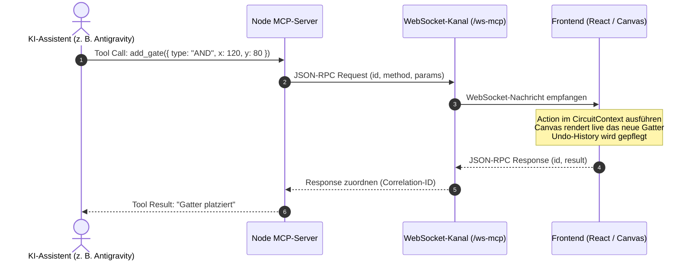

# Model Context Protocol (MCP) Integration

[← Zurück zur Übersicht](intro.md) • [📋 Zum Scrum-Board](scrum-board.md)

Dieses Dokument spezifiziert das architektonische Konzept zur Integration eines **Model Context Protocol (MCP)** Servers in **Logic Circuit Web**. Ziel ist es, KI-Assistenten (wie Antigravity oder Claude) in die Lage zu versetzen, Schaltungen in Echtzeit zu analysieren, Fehler zu diagnostizieren, Bauteile und Leitungen zu modifizieren sowie Simulationen interaktiv zu testen.

---

## Kernarchitektur: Frontend als Source of Truth

Die Schaltungsdefinitionen (`CircuitProject`), das Platzierungsmodell (`CircuitSymbol`, `Wire`), der Render-Canvas und die logische Simulations-Engine laufen vollständig im Browser.

Aus diesem Grund arbeitet der MCP-Server als **zustandslose Bidirektionale Bridge**:
- Der KI-Assistent kommuniziert über das standardisierte MCP-Protokoll (stdio oder HTTP/SSE) mit dem Node.js-Backend.
- Das Node.js-Backend leitet die Werkzeugaufrufe (Tool Calls) über eine WebSocket-Verbindung in Echtzeit an die geöffnete Frontend-Instanz weiter.
- Das Frontend führt die Aktionen direkt im `CircuitContext` und `SimulationContext` aus und sendet das Ergebnis über den WebSocket zurück.



### Wesentliche Vorteile dieses Ansatzes
- **Keine Redundanz:** Schaltungsmodell, Validierungsregeln und Simulations-Engine müssen nicht in Node.js doppelt gepflegt werden.
- **Echtzeit-Feedback:** Der Anwender sieht Änderungen der KI ohne Verzögerung direkt auf dem interaktiven Canvas.
- **Mensch-in-the-Loop & Undo:** Da die Änderungen über dieselben internen Aktionen des Frontends laufen, bleibt die Undo/Redo-Historie (`Strg+Z`) intakt.
- **Aktiver Simulationszustand:** Dynamische Signalwerte, Taktschritte und Probes können direkt aus dem laufenden Browser-Speicher abgefragt werden.

---

## Dual-Hosting: Lokales Development (Vorrang) & Remote MCP

Um sowohl im schnellen Entwickler-Alltag als auch auf einer öffentlich gehosteten Web-Instanz (z. B. hinter Caddy / `http-server`) zu funktionieren, trennt die Architektur strikt zwischen **lokalem HMR-Modus** und **Remote-Relay-Modus**:

```text
server/
├── mcpBridge.ts            # Gemeinsamer Request-/Response-Korrelationsmanager
├── vitePluginMcp.ts        # Vite Dev-Server Plugin (für "yarn dev", Vorrang)
├── webSocketConnection.ts  # Abhängigkeitsfreier RFC-6455 WebSocket-Parser & -Server
├── mcpRelay.ts             # Zustandsloses RAM-Relay für Multi-Session-Routing
├── standaloneServer.ts     # Node.js HTTP- & WebSocket-Server (Sidecar / Release)
└── bin/
    └── mcpCli.mjs          # Stdio-Adapter für lokale & Remote-KI-Clients

src/mcp/
├── mcpEvents.ts            # Kanal-Bezeichner, Pfade und Protokollkonstanten
├── mcpTools.ts             # MCP Tool-Handler im Frontend
├── toolDefinitions.json    # MCP Tool-Definitionen und JSON-Schemata
├── mcpRemoteRouter.ts      # Multi-Tab-Routing & Tab-Registry (reine Logik)
├── mcpSharedWorker.ts      # SharedWorker-Entrypoint (eine WebSocket-Verbindung pro Origin)
└── mcpRemoteClient.ts      # Frontend-Transport inkl. Single-Tab-WebSocket-Fallback

src/components/statusBar/
└── mcpRemotePopover.tsx    # Pairing-Dialog, Chat-Prompt-Generator & Tab-Aktivierung

src/utils/
└── mcpStorage.ts           # Access-Key-Speicherung & Prompt-/Config-Builder

Dockerfile.mcp              # Schlankes Node-22-Alpine-Sidecar-Image (Port 3001)
deploy/Caddyfile.example    # Caddy-Reverse-Proxy-Konfiguration für /ws-mcp und /__mcp/*
```

### Lokales Development (`yarn dev`, absoluter Vorrang)
- Sobald `import.meta.hot` im Browser verfügbar ist, greift ausschließlich der lokale Vite-Dev-Modus.
- `vitePluginMcp.ts` klinkt sich über `configureServer(server)` in Vite ein und nutzt den bestehenden HMR-WebSocket (`server.ws`) sowie `GET /__mcp/status` und `POST /__mcp/call`.
- Kein separater Hintergrunddienst, kein Pairing-Code und kein Access-Key erforderlich – `yarn dev` aktiviert die Schnittstelle sofort (`MCP (Lokal)` in der Statusleiste).

### Remote MCP im Production-Betrieb (GDPR-konform, US-018)
- **Kein Login & keine Datenspeicherung:** Das Backend (`standaloneServer.ts` / `mcpRelay.ts`) speichert weder Benutzerkonten noch Schaltungsdaten oder Logs auf der Festplatte. Alle Sitzungen (`sessionId` + flüchtiges Secret) existieren ausschließlich temporär im Arbeitsspeicher (RAM).
- **Opt-in statt Dauerverbindung:** Normale Besucher einer öffentlichen Instanz öffnen keine WebSocket-Verbindung. Erst bei expliziter Aktivierung durch den Nutzer wird eine Verbindung zu `/ws-mcp` aufgebaut.
- **Multi-Tab-Koordination per `SharedWorker`:** Ein `SharedWorker` verwaltet alle offenen Tabs derselben Origin über genau **eine** WebSocket-Verbindung und routet eingehende MCP-Aufrufe gezielt an den vom Nutzer aktivierten Tab (mit Single-Tab-Fallback für Browser ohne `SharedWorker`).
- **Optionaler geheimer Zugang (`MCP_ACCESS_KEY`):** Über die Server-Umgebungsvariable `MCP_ACCESS_KEY` lässt sich der Zugang bei Bedarf auf ausgewählte Personen beschränken (Prüfung beim WebSocket-Handshake sowie per Bearer-Token bei `POST /__mcp/call`).
- **Reverse-Proxy- & Sidecar-Betrieb:** Der Node-Server kann als leichter Sidecar-Container (z. B. im selben Docker-Netzwerk neben einem statischen `http-server`) laufen; Caddy routet `/ws-mcp` und `/__mcp/*` an den Sidecar.

### Anbindung an die KI (Transportwege)
- **Stdio-Bridge (`server/bin/mcpCli.mjs`):** Standard-Weg für Desktop-KI-Clients (Antigravity, Claude Desktop). Der CLI-Prozess kommuniziert per Stdio mit dem KI-Client und sendet Aufrufe per `POST ${LOGIC_CIRCUIT_URL}/__mcp/call` an den Dev-Server bzw. das Remote-Relay.
- **Dynamisches Session-Pairing im Remote-Modus:** In `mcp_config.json` wird keine feste Session-ID eingetragen. Stattdessen erzeugt der Browser-Verbindungsdialog eine flüchtige `sessionId` samt kopierbarem Chat-Prompt (*„Nutze für Logic Circuit Anfragen folgende SessionID: …”*). Der KI-Client übergibt sie einmalig über `set_remote_session` an `mcpCli.mjs`; ohne gültige `sessionId` meldet der MCP-Server gezielt einen Fehler.
- **Umgebungsvariablen:** Lokal reichen die Defaults (`http://localhost:5173`). Für Remote-Instanzen unterstützt `mcpCli.mjs` `LOGIC_CIRCUIT_URL`, `LOGIC_CIRCUIT_TOKEN` (optionaler `MCP_ACCESS_KEY`), `LOGIC_CIRCUIT_TIMEOUT_MS` sowie optional `LOGIC_CIRCUIT_SESSION` als Fallback.

---

## Werkzeugkatalog (MCP Tools)

Die Schnittstelle stellt der KI fokussierte Werkzeuge in drei Hauptbereichen bereit:

### Analyse & Inspektion
- `get_circuit_summary`: Liefert Metadaten der aktuellen Schaltung (ID, Name, Anzahl von Symbolen, Leitungen, Pins und Probes).
- `get_circuit_details`: Gibt den detaillierten Netzplan aus (platzierte Gatter, Koordinaten, Pin-Jams, Leitungsführungen).
- `get_circuit_image`: Erzeugt einen PNG-Screenshot des aktuellen Viewports (`viewport`), der gesamten Schaltung (`circuit`) oder eines gezielten Ausschnitts per **Raster-Rechteck** (`gridRect: { x, y, width, height }`) bzw. **Bauteileliste** (`symbolIds`) inklusive optionalem `margin` und Filter für nicht genannte Bauteile (`unrelatedSymbols: "show" | "dim" | "hide"`).
- `validate_circuit`: Prüft die Schaltung (inkl. eingebundener Subschaltungen) auf Konstruktionsfehler wie unbeschaltete Eingänge, Rekursionsschleifen, Bitbreiten-Konflikte oder Kurzschlüsse durch mehrere Treiber auf einem Netz.

### Modifikation & Konstruktion (Mutations)
- `add_elements`: Platziert ein oder viele Bauteile, Textnotizen und Leitungen (inkl. `ref`-Referenzen auf neu erzeugte Symbole) atomar in einem einzigen Aufruf und Undo-Schritt.
- `connect_wire`: Zieht eine Leitungsverbindung zwischen zwei Koordinaten oder Bauteil-Jams.
- `delete_elements`: Entfernt gezielt Symbole, Textnotizen oder Leitungen über deren IDs.
- `move_elements`: Verschiebt Symbole, Textnotizen und Leitungen gemeinsam um `(dx, dy)` in einem Undo-Schritt.
- `rotate_symbols`: Rotiert Symbole, Textnotizen und optional Leitungen (`wireIds`) um 90 Grad im oder gegen den Uhrzeigersinn.
- `set_current_circuit`: Wechselt die aktive Schaltung im Editor per `circuitId`.
- `update_circuit_properties`: Passt Name, Kategorie und Notiz/Beschreibung einer Schaltung an.
- `create_circuits`: Erzeugt eine oder mehrere neue (Sub-)Schaltungen im Projekt in einem Aufruf.
- `delete_circuits`: Entfernt eine oder mehrere unreferenzierte Schaltungen aus dem Projekt.

### Simulation & Frame-genaue Auswertung (`X` Frames)
- `set_input_signal`: Setzt oder schaltet einen oder mehrere Eingangs-Taster/Schalter (`CircuitButton`) deterministisch um.
- `step_simulation`: Zentrales Simulationswerkzeug zum Starten, Pausieren, Stoppen, Zurücksetzen (`action`), deterministischen Fortschreiten um exakt `X` Takte/Frames (`steps`, auch ohne Taktgeber), zeitgesteuerten Eingabe-Events innerhalb desselben Aufrufs (`events` mit `atStep`) auf einer wählbaren Root-Schaltung (`circuitId`) inklusive optionaler Statusauswertung (`includeState`, filterbar per `symbolIds`), eindeutigem Subschaltungs-Instanzpfad (`instancePath`) und direktem Screenshot (`includeScreenshot`) in einem Aufruf.

---

## Frontend-Integration

Im Frontend verbindet sich der Hook (`useMcpBridge`) je nach Umgebung:

- **Lokales Development (Vorrang):** Ist `import.meta.hot` verfügbar, läuft die Kommunikation direkt über den Vite-HMR-WebSocket (`MCP (Lokal)` in der Statusleiste).
- **Remote-Betrieb (Production):** Ohne `import.meta.hot` verbindet sich der Hook auf explizites Opt-in über einen `SharedWorker` (`mcpSharedWorker.ts`, mit Single-Tab-Fallback) mit `/ws-mcp`. Jeder Tab meldet eine zufällige `tabId`; nur der vom Nutzer in der Statusleiste aktivierte Tab beantwortet eintreffende Werkzeugaufrufe.
- **Eintreffende Requests:** JSON-Payload mit `{ id: string, method: string, params: unknown }`.
- **Ausführung:** Abfrage oder Manipulation über `CircuitContext` und `SimulationContext`.
- **Quittierung:** Rückmeldung an Node via `{ id: string, result: unknown }` bzw. `{ id: string, error: string }`.
- **Sitzungsverwaltung:** Antwortet der Server ohne aktive Browsersitzung (oder ohne passenden Pairing-Code), erhält die KI eine klare Hinweismeldung.

---

## Roadmap & Scrum-Einordnung

Sämtliche Meilensteine der lokalen und Remote-MCP-Integration (US-009, US-018 und US-019 mit den Tasks T-017 bis T-021, T-024 sowie T-051 bis T-057) sind vollständig in Release 1.0 umgesetzt. Die detaillierte Übersicht befindet sich in der Chronik **[Was bisher geschah – Release-Chronik](history.md)**.

---

## Konfiguration für KI-Clients

Zur Anbindung an Antigravity oder Claude Desktop wird die Stdio-Bridge in der lokalen `mcp_config.json` registriert.

### Lokales Development (`yarn dev`)

```json
{
  "mcpServers": {
    "logic-circuit": {
      "command": "node",
      "args": ["server/bin/mcpCli.mjs"]
    }
  }
}
```

Voraussetzung im lokalen Betrieb: `yarn dev` läuft und die Webanwendung ist in einem Browser-Tab geöffnet (`MCP (Lokal)` aktiv).

### Remote-Betrieb

```json
{
  "mcpServers": {
    "logic-circuit-remote": {
      "command": "node",
      "args": ["server/bin/mcpCli.mjs"],
      "env": {
        "LOGIC_CIRCUIT_URL": "https://circuit.example.com",
        "LOGIC_CIRCUIT_TOKEN": "<optionaler-access-key>"
      }
    }
  }
}
```

Die flüchtige `sessionId` wird **nicht** in der IDE-Konfiguration festgeschrieben, sondern im Verbindungsdialog der Web-App als fertiger Chat-Prompt erzeugt und dem KI-Client im Chat mitgeteilt (z. B. `Nutze für Logic Circuit Anfragen folgende SessionID: xxyy-aabb-1234-qwer`). Ohne gesetzte `sessionId` meldet der MCP-Server im Remote-Modus einen entsprechenden Fehler.

---

## Docker-Sidecar- & Reverse-Proxy-Deployment

Die statische Auslieferung der Webanwendung kann über einen beliebigen HTTP-Server-Container (z. B. als `logiccircuit-web`) erfolgen. Der Remote-MCP-Endpunkt läuft daneben als schlanker, zustandsloser Node-Sidecar ohne externe npm-Abhängigkeiten.

### Sidecar-Image bauen und starten

- **Image bauen:**

```bash
docker build -f Dockerfile.mcp -t logiccircuit-mcp .
```

- **Sidecar-Container starten:**

```bash
docker run -d --rm \
  --name logiccircuit-mcp \
  --read-only \
  --cap-drop=ALL \
  -e MCP_ACCESS_KEY="<optionaler-access-key>" \
  -e MCP_ALLOWED_ORIGINS="https://circuit.example.com" \
  logiccircuit-mcp
```

Der Container läuft als Non-Root-Benutzer (`node`), lauscht standardmäßig auf Port `3001` (`HOST=0.0.0.0`) und prüft seine Gesundheit über `GET /healthz`. Mit `--read-only` und `--cap-drop=ALL` wird sichergestellt, dass keinerlei Zustand lokal geschrieben wird.

### Umgebungsvariablen des Standalone-Servers (`server/standaloneServer.ts`)

| Variable | Default | Beschreibung |
| :--- | :--- | :--- |
| `PORT` / `MCP_PORT` | `3001` | HTTP- & WebSocket-Port des Relay-Servers |
| `HOST` | `0.0.0.0` | Bind-Adresse |
| `MCP_ACCESS_KEY` | *(leer)* | Optionales Shared-Secret für WebSocket-Handshake (`HELLO`) und `Authorization: Bearer ...` auf `/__mcp/call` |
| `MCP_ALLOWED_ORIGINS` | *(leer)* | Komma-separierte Origin-Whitelist für WebSocket-Upgrades (z. B. `https://circuit.example.com`) |
| `MCP_REQUEST_TIMEOUT_MS` | `600000` | Timeout pro Tool-Ausführung in Millisekunden (Standard: 10 Minuten) |
| `MCP_SESSION_GRACE_MS` | `120000` | Kulanzzeit für kurzzeitigen Reconnect derselben `sessionId` mit `reconnectToken` |
| `MCP_HEARTBEAT_INTERVAL_MS` | `25000` | Intervall für Server-seitige WebSocket-Pings |
| `MCP_STATIC_DIR` | *(leer)* | Optionaler Pfad für ein einzelnes All-in-One-Container-Setup ohne separaten Webserver |
| `PRIVACY_RESPONSIBLE_NAME` | *(leer)* | Name des Verantwortlichen für den DSGVO-Dialog (`GET /__mcp/privacy`, auch zur Build-Zeit über `.env.local`) |
| `PRIVACY_RESPONSIBLE_ADDRESS` | *(leer)* | Anschrift des Verantwortlichen für den DSGVO-Dialog |
| `PRIVACY_CONTACT_EMAIL` | *(leer)* | Kontakt-E-Mail-Adresse für Datenschutzanfragen (`mailto:`-Link im Dialog) |
| `PRIVACY_HOSTING_LOCATION` | *(leer)* | Hosting-Hinweis im DSGVO-Dialog (z. B. `Deutschland, Frankfurt`) |

### Reverse-Proxy-Routing (Caddy)

- Eine Beispiel-Konfiguration liegt unter `deploy/Caddyfile.example`.
- Caddy terminiert HTTPS und leitet ausschließlich `/ws-mcp` sowie `/__mcp/*` an `logiccircuit-mcp:3001` weiter; alle übrigen Pfade werden vom statischen Webserver (`logiccircuit-web:8080`) beantwortet.
- Für längere Simulationen sowie ruhige WebSockets setzt das Beispiel `read_timeout 10m` und `write_timeout 10m`. Optional verhindert `# log_skip @mcp` (ab Caddy 2.7+) serverseitige Access-Logs für MCP-Pfade.
- **Kurze Funktionsprüfung nach dem Ausrollen:**
  - `docker ps` prüfen (`logiccircuit-mcp` im Status `(healthy)` auf Port `3001/tcp`).
  - `curl -fsS https://circuit.example.com/__mcp/status` → liefert JSON mit `activeSessions`, `pendingRequests` und `authRequired`.
  - `curl -fsS https://circuit.example.com/__mcp/privacy` → liefert die gesetzten `PRIVACY_*`-Felder als JSON.
