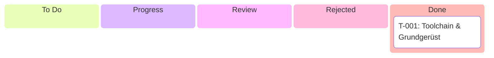

# 💻 Logic Circuit Web Scrum- & Kanban-Board

**Workflow:** Kontinuierlicher Flow (Feature-by-Feature ohne Sprint-Zeitdruck)  
**Fokus:** Portierung und Weiterentwicklung von Logic Circuit als performante, browserbasierte Webanwendung mit TypeScript, React, Vite und Emotion.

---

## 🚀 Aktive User Story

### [US-001: Projekt-Setup und Toolchain-Grundgerüst](user_stories/US-001-projekt-setup-und-grundgeruest.md)
*Status: In Bearbeitung • Priorität: Hoch*

**Tasks:**
- ✅ [T-001: Projekt-Setup, Toolchain und Referenz-Submodul](tasks/T-001-projekt-setup-und-toolchain.md)

---

## ✅ Abgeschlossene User Stories

| Story | Titel | Abgeschlossene Tasks & Fixes |
| :--- | :--- | :--- |

---

## 📖 Backlog (Zukünftige User Stories)

| Story | Titel | Priorität | Kurzbeschreibung |
| :--- | :--- | :--- | :--- |
| **US-002** | Schematics Canvas und Raster-Navigation | Hoch | Zoom- und panbarer SVG/HTML5-Canvas mit Punktraster, Koordinaten-Snapping und Selektionsrahmen. |
| **US-003** | Grundlegende Logik-Gatter und Komponenten-Palette | Hoch | Seitenleiste mit Gattern (AND, OR, NOT, XOR, NAND, NOR) und Drag&Drop auf den Canvas. |
| **US-004** | Leitungsverlegung und Signal-Knoten (Wires & Conductors) | Hoch | Orthogonale Leitungsführung zwischen Komponenten-Pins mit Kreuzungen und Verzweigungspunkten. |
| **US-005** | Digitale Simulations-Engine und Signal-Propagation | Hoch | Eventbasierte oder getaktete Logik-Engine zur Berechnung von Signalstufen (Low, High, Undefined). |
| **US-006** | Interaktive I/O-Elemente (Taster, Schalter, Probes, 7-Segment) | Mittel | Interaktives Schalten von Eingängen und visuelle Zustandsanzeige an Ausgängen und Displays. |
| **US-007** | Hierarchische Schaltungen (Sub-Circuits) | Mittel | Wiederverwendung von gezeichneten Teilschaltungen als gekapselte Komponentenbausteine. |
| **US-008** | LogicCircuit XML-Projektformat Import & Export | Mittel | Lesen und Speichern nativer `.LogicCircuit`-Projektdateien aus der C#-Desktopanwendung. |

---

## 🐛 Gemeldete Bugs & Fehlertracking

| Bug | Titel | Priorität | Status | Kurzbeschreibung |
| :--- | :--- | :--- | :--- | :--- |

---

> 💡 **Hinweis zur Pflege:**
> - **Tasks:** Werden nach dem Schema `[T-XXX: Titel]` gepflegt (Vorlagen in [`docs/tasks/`](tasks/)).
> - **Bugs:** Größere Bugs werden dokumentiert (Vorlagen in [`docs/bugs/`](bugs/)); direkte Review-Fixes werden ohne Task-Overhead direkt behoben.
> - **Status-Spalten & Task-Icons:**
>   - 📋 `To Do` (Offen / Geplant)
>   - 🟡 `Progress` (In aktiver Bearbeitung)
>   - 🔍 `Review` (Implementiert, wartet auf Abnahme)
>   - ❌ `Rejected` (Abgelehnt / Nacharbeit erforderlich)
>   - ✅ `Done` (Erfolgreich abgenommen & abgeschlossen)

